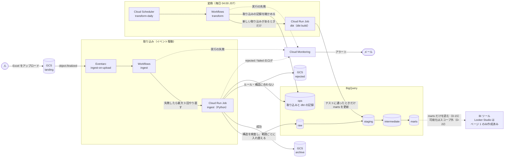
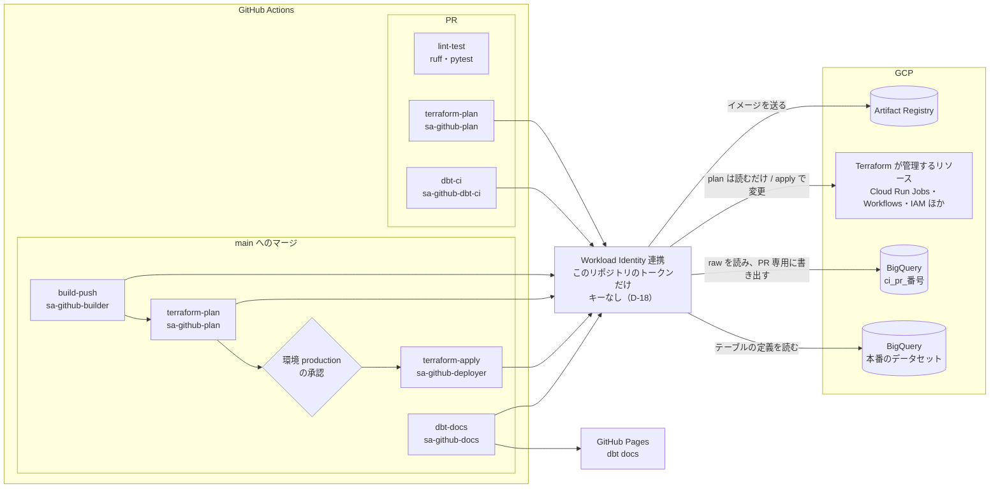

# 観光統計データ基盤 仕様書

作成日：2026年11月3日
対象：訪日外国人消費動向調査・宿泊旅行統計調査の分析基盤（学習・ポートフォリオ用）

---

## 1. 概要

### 1.1 目的

観光庁の2つの統計（訪日外国人消費動向調査・宿泊旅行統計調査）を BigQuery にデータウェアハウス（DWH）として蓄積し、BIツールからそのまま読める集計表（marts）まで整える。データ変換は dbt で管理し、インフラは Terraform で管理する。新しいExcelファイルを GCS にアップロードするだけでデータが更新される仕組みを作る。

可視化（ダッシュボード）はスコープ外とする。Looker Studio はページ1（サマリ）だけを、marts をBIツールから読めることの動作確認として作成した（D-22）。

### 1.2 ポートフォリオとして見せたいこと

| 観点 | 実現方法 |
|---|---|
| データモデリング | dbtで raw → staging → intermediate → marts の層を作る |
| データ品質 | dbt testsで品質を確かめてから集計表を更新する。取り込み時にはExcelの構造を検査する |
| イベント駆動の処理 | GCSへのアップロードをきっかけに Eventarc → Workflows → Cloud Run Jobs が動く |
| 冪等性（同じファイルを何度取り込んでも結果が同じ） | 「調査・年・期・公表区分」の単位でデータを丸ごと入れ替える。取り込みの記録で二重処理を防ぐ |
| インフラのコード管理 | Terraformで管理し、GitHub Actionsからキーを使わずに認証する |
| CI/CD | PRごとに検査とdbtのCIを動かし、mainへのマージでデプロイする |
| データの流れの見える化 | dbt docs（リネージ）を公開し、rawからmartsまでの流れと、各モデル・各列の説明をたどれるようにする |
| BIツールへのつなぎ口 | martsを、結合と推計を済ませた小さな実テーブルにし、どのBIツールからも1つのグラフに1つのmartをつなぐだけで使えるようにする（D-08、D-09） |

### 1.3 スコープ

| 対象 | 対象外 |
|---|---|
| 宿泊旅行統計調査（年確定値、2016年〜） | 新しい公表の通知・自動検出（D-03） |
| 訪日外国人消費動向調査（暦年・四半期、2016年〜、速報・確報） | 観光庁サイトの読み取り（スクレイピング） |
| 手動アップロードをきっかけにした取り込みとDWHの更新 | 宿泊旅行統計の月次速報（将来の拡張） |
| dbtによる変換・テスト・ドキュメント | JNTOの訪日外客数（将来の拡張） |
| BIツールから読める集計表（marts） | 可視化（ダッシュボード）の作成（D-22。Looker Studioはページ1のみ、動作確認として作成済み）、Looker StudioのTerraform管理（D-14） |
| TerraformによるGCPリソースの管理 | 開発用と本番用でGCPプロジェクトを分けること（D-13） |
| GitHub ActionsによるCI/CD | リアルタイムでの反映 |

> **D-22：可視化はスコープ外にし、martsをBIツールのつなぎ口として整えるところまでとする**
> このポートフォリオで見せたいのは、取り込み・変換・テスト・インフラの設計である。Looker Studioのページは画面での手作業で作るしかなく（D-14）、ページを増やしても基盤の設計はほとんど見えない一方で、作る手間と、手順を文書に残す手間が大きい。そこで、martsを「BIツールからそのまま読める状態」に整えるところまでを対象にし、ページ1（サマリ）だけを動作確認として作った時点で可視化を止める。martsはダッシュボードのページ単位の設計（D-09）のまま残すので、あとからLooker StudioやTableauなどでページを作るときも、martsを作り直す必要はない。データの流れは、ダッシュボードの代わりにdbt docs（リネージ）で見せる（7.6）。

---

## 2. 全体のアーキテクチャ

GCPのリソースはすべて1つのプロジェクト（asia-northeast1）に置く（D-13）。

### 2.1 データの流れ



- 取り込み：landingへのアップロードをきっかけに、Cloud Run Job「ingest」がパスの検証 → Excelの構造の検査 → 縦持ちへの変換をし、raw層の該当する範囲を入れ替える（5章）。成功したファイルはarchiveへ、不正なファイルはrejectedへ移し、結果を `ops.ingestion_log` に記録する。
- 変換：毎日04:00に、前回のdbtの実行のあとに取り込みがあったときだけ `dbt build` を実行する（D-12）。テストに落ちると、その先のmartsは更新されない。
- BIツール：martsだけを参照する（D-15）。可視化はスコープ外で（D-22）、Looker Studioはページ1だけを動作確認として作った。
- 監視：取り込みのrejected / failedと、Workflowsの失敗をメールで通知する（13章）。

### 2.2 CI/CDと認証



- GitHub ActionsからGCPへは、Workload Identity連携でキーを使わずに認証する（D-18）。ジョブごとにサービスアカウントを分ける（11章）。
- mainへのマージでは、イメージを作り、承認の前にplanを出し、GitHubの本番環境 `production` の承認を経てからapplyする。dbt docsはGitHub Pagesに公開する（12章）。

---

## 3. データソース

### 3.1 対象の統計と表

| 調査 | 集計期間 | 公表区分 | 取り込む表 | 入手先 |
|---|---|---|---|---|
| 宿泊旅行統計調査 | 暦年（1ファイルに年計と1〜12月を含む） | 年確定値のみ | martsで使う5表（第1表、第2表、第4表、第8表、参考第1表） | e-Statのファイル |
| 訪日外国人消費動向調査 | 暦年・四半期 | 1次速報・2次速報・確報 | 表2-1、表3-1、表3-4、表4-1、表6-1 | e-Stat・観光庁サイトのExcel |

- どちらの調査も、martsで使う表だけを取り込む（見出し定義がある表だけを読む）。表を増やすときは、見出し定義を足せばよく、rawのテーブル定義は変わらない（D-07）。
- 宿泊旅行統計は、最初は全21表を取り込んでいた。2026-11 に、使っていない表の見出し定義を消した。それより前に取り込んだ年のrawには、ほかの表の行も残っている。

### 3.2 既知の形式の違い

| 調査 | 期間 | 形式 | 対応 |
|---|---|---|---|
| 宿泊旅行統計 | 2016〜2019年 | 旧形式（結合セル・注記付き・単位の行なし） | 新形式の見出し定義を列の位置で当てはめる（D-06） |
| 宿泊旅行統計 | 2020年〜 | 新形式（見出しが4段） | 見出し定義と照合する |
| 宿泊旅行統計 | 2016年、2020〜2024年 | 地域コードの列がない | rawにはExcelにあるコードだけを入れ、stagingで `seed_prefecture` から補う |
| 消費動向調査 | 2016・2017年（暦年） | 表番号が旧形式（第N表）。表3-4（訪問地別の1泊当たり消費単価）がない。総数の列が「全体」、費目名が一部違う（宿泊料金など） | `consumption_v1`。見出し定義にシート名を持たせ「表X-Y」にそろえる |
| 消費動向調査 | 2018年〜2025年（暦年・四半期） | 「表X-Y」形式、国籍・地域は21区分 | `consumption_v2`。2024年4–6月期からの新調査（インバウンド消費動向調査）も同じ形式だった |
| 消費動向調査 | 2026年〜 | 国籍・地域が24区分（メキシコ・北欧・中東を追加） | `consumption_v3` |
| 消費動向調査 | 1次速報 | 地域調査（B1）の表（表3-4・表6-1）がない | 見出し定義の `releases` で、1次速報では読まない |
| 消費動向調査 | 2020・2021年 | 暦年の集計表がなく、四半期1期分だけ | 四半期として取り込み、martsで注記する（`int_consumption_yearly_periods`） |

---

## 4. GCSの設計

### 4.1 バケット

| バケット | 用途 | 設定 |
|---|---|---|
| `{project}-landing` | アップロード先。Eventarcの監視対象 | 版の保存：有効、保存期間：30日で削除（古い版も、版でなくなってから30日で削除） |
| `{project}-archive` | 取り込みに成功した元ファイルを保管する | 版の保存：有効、削除しない |
| `{project}-rejected` | 不正なファイルを隔離する | 90日で削除 |
| `{project}-tfstate` | Terraformの状態ファイル | 版の保存：有効（最初の1回だけ手作業で作る） |

> **D-01：フォルダではなくバケットを分ける**
> Eventarcの Cloud Storage トリガーは、絞り込みの条件にバケットしか使えない（フォルダ単位の指定ができない）。同じバケット内で archive/ や rejected/ へ移動すると、それがまた新しいイベントになり、取り込みが繰り返し起動してしまう。用途ごとにバケットを分ければ、landing だけを確実に監視できる。

### 4.2 アップロードするパスのルール

```
gs://{project}-landing/{survey}/{period_type}/{year}[_Q{quarter}][_{release}].{xlsx|xls}
```

| 要素 | 値 | 説明 |
|---|---|---|
| `survey` | `overnight` / `consumption` | 調査の種類 |
| `period_type` | `annual` / `quarterly` | 集計期間 |
| `year` | 4桁の数字 | 対象の年 |
| `_Q{quarter}` | `_Q1`〜`_Q4` | `quarterly` のときは必須。`annual` のときは付けない |
| `_{release}` | `_preliminary1` / `_preliminary2` | 省略したら確報（`final`）として扱う |

**例**

| パス | 意味 |
|---|---|
| `overnight/annual/2026.xlsx` | 宿泊旅行統計 2026年 年確定値 |
| `consumption/annual/2025.xls` | 消費動向調査 2025年 暦年 確報 |
| `consumption/quarterly/2026_Q3_preliminary1.xlsx` | 消費動向調査 2026年7–9月期 1次速報 |

**検証のルール**（ルールに合わないファイルは rejected に移す）
- 正規表現：`^(overnight|consumption)/(annual|quarterly)/(\d{4})(_Q[1-4])?(_preliminary[12])?\.(xlsx|xls)$`
- `quarterly` なのに `_Q` がない、または `annual` なのに `_Q` がある → 取り込まない
- `overnight` で `quarterly` や速報を指定している → 取り込まない（宿泊旅行統計は年確定値だけが対象）

> **D-02：ファイルの種類はパスのルールで見分ける**
> ファイル名やExcelの中身から推測する方法もあるが、元のファイル名は年や配信元によってばらばらで、推測は外れることがある。アップロードする人に決まりを守ってもらい、決まりに合わないものは止める方が、間違ったデータが静かに入り込むことを防げる。人が関わる工程が1つなので、決まりを強制する負担は小さい。

> **D-03：新しい公表の通知・自動検出はスコープ外**
> 公表は年に数回で、手動でアップロードしても負担は小さい。観光庁サイトの読み取りはサイトの作りが変わると壊れやすく、e-Statのカタログには一部の年がない。まずは取り込み以降の仕組みを確実に作ることを優先する。将来、e-Statのカタログ（ファイル一覧）APIで新しい公表を見つけて通知する機能を足せる設計にしておく。

---

## 5. 取り込み（ingest）

### 5.1 処理の流れ

```
Eventarc（バケット・オブジェクト名・世代番号）
  └▶ Workflows「ingest」
        └▶ Cloud Run Job「ingest」（実行時の引数でオブジェクト名と世代番号を渡す）
              1. 二重処理の確認：ingestion_log で (source_uri, generation) が成功済みなら、「skipped」を記録して終わる
              2. 取り込みの記録を「running」で書き込む
              3. パスを検証し、調査・期間・年・期・公表区分を取り出す        ── 不正なら rejected へ
              4. Excelをダウンロードし、形式のバージョンを判定する
              5. 構造を検査する：シートの有無、列の数、見出しの文字（定義と照合）、
                 シートに書かれた期間・公表区分がパスと同じか（消費動向）       ── 不正なら rejected へ
              6. 縦持ちに変換し、行ごとに検査する（地域・項目が空でないか、値が数値または記号か）
              7. BigQueryの一時テーブルに読み込む
              8. トランザクションの中で、raw の該当範囲を DELETE → INSERT する
              9. 元ファイルを archive に移す（名前に世代番号を付ける。例：`2026__{世代番号}.xlsx`）。landing からは消す。rejected へ移すときも同じ名前にする
             10. 取り込みの記録を「succeeded」と行数で更新する
```

- 結果（status・source_uri・世代番号など）は、1行のJSONの構造化ログでも出す。rejected / failed のログは監視の対象になる（13章）。

### 5.2 終了の種類とやり直し

| 種類 | 例 | 終了コード | Workflowsの動き | 通知 |
|---|---|---|---|---|
| succeeded | 正常に終わった | 0 | 終わる | なし |
| skipped | 同じ世代のファイルがすでに取り込み済み | 0 | 終わる | なし |
| rejected | パスの違反、構造の不一致、行の検査で不合格 | 0（rejected として記録） | 終わる（やり直さない） | あり |
| failed | BigQueryやGCSの一時的なエラー | 1 | 間隔を広げながら最大3回やり直す（ジョブを起動できなかったときも同じ） | 失敗のたびに通知（ログの指標）。3回やり直しても失敗したら、Workflowsの失敗としても通知 |

> **D-04：データの誤りと一時的なエラーを分ける**
> 構造が合わないExcelは何度やり直しても失敗するので、やり直すのは無駄である。データの誤りは rejected として隔離し、人に知らせる。やり直しは一時的なエラーのときだけにする。

### 5.3 二重処理を防ぐ仕組み

- GCSのイベントは「少なくとも1回」届く仕組みなので、同じ通知が2回以上届くことがある。`(source_uri, generation)` の組で、成功済みかどうかを確かめる。
- 同じパスにファイルを上げ直すと世代番号が変わるので、上げ直しは新しい取り込みとして扱われる。数値が改定されたファイルを取り込み直すときは、これを使う。

### 5.4 raw層への書き込み（入れ替えの単位）

| 調査 | 入れ替えの単位 |
|---|---|
| overnight | `(year, release_status)` |
| consumption | `(year, quarter, release_status)`（暦年は quarter = 0） |

```sql
BEGIN TRANSACTION;
DELETE FROM raw.consumption_cells WHERE year = @year AND quarter = @quarter AND release_status = @release;
INSERT INTO raw.consumption_cells SELECT * FROM raw._tmp_xxx;
COMMIT TRANSACTION;
```

複数のファイルを一度に上げると、同じテーブルへのトランザクションがぶつかり、BigQuery が片方を中断する（`Transaction is aborted due to concurrent update`）。待てば通るエラーなので、ingest の中で間隔を空けて最大10分やり直す（10年分を同時に上げたときは、21回の中断がすべてこれで解消した）。

> **D-05：追記ではなく、決まった単位で丸ごと入れ替える**
> 追記にすると、上げ直しや数値の改定で同じ期のデータが二重に入る。単位を決めて入れ替えれば、何度実行しても結果は同じになる。トランザクションを使うので、入れ替えの途中の状態が外から見えることもない。
> 公表区分ごとに分けて残すので、1次速報と確報を比べることもできる。どの区分を使うかはstaging層で決める（7.2節）。

### 5.5 見出しの定義ファイル

- 表ごとの見出し定義をリポジトリに置く。最新形式のExcelから開発用のスクリプト（`scripts/generate_header_defs.py`）で作り、人が確認してからコミットする。

| 調査 | 置き場所 | 中身 | 照合のしかた |
|---|---|---|---|
| 宿泊 | `ingest/header_defs/overnight/{table_id}.json` | 期間（年計・各月のシート）、列ごとの位置・target（全体/外国人）・group・sub・item・unit | 新形式は項目と単位を照合する。旧形式（2016〜2019年）は列の数だけを照合し、定義を列の位置で当てはめる |
| 消費動向 | `ingest/header_defs/consumption/{format_version}/{table_id}.json` | シート名、列の区分（国籍･地域 / 訪問地）、国籍・訪問地の並び、指標と単位（塊ごと）、対象の公表区分（releases） | 列の見出し（国籍・訪問地と指標）を照合する。新しいバージョンから順に当てはめ、最初に合ったものを形式のバージョンにする |

- 消費動向調査の行の見出し（入国空港の一覧、属性の区分など）は年によって増減するため照合しない。シートのものを `row_category` / `row_item` に入れ、意味付けは staging で行う。内訳の行は「親の項目／内訳」（例：`交通費／バス`）とする。

> **D-06：見出しの定義をコードとしてリポジトリで管理する**
> 基盤を作る前の取得スクリプト（`fetch_overnight_trips.py`。リポジトリには移していない）は、同じ実行の中で新しい年を先に読み、その見出しを旧形式の年に当てはめている。1ファイルずつ処理する方式では、ほかの年のファイルが手元にないので、この方法は使えない。定義をファイルにしておけば1ファイルだけで処理できる。また定義の変更がGitの差分としてレビューできるので、形式の変化に気づきやすくなる。

### 5.6 実行環境

| 項目 | 値 |
|---|---|
| 言語 | Python 3.12（依存ライブラリは uv で管理） |
| 主なライブラリ | pandas、openpyxl、xlrd、google-cloud-storage、google-cloud-bigquery |
| Cloud Run Job | メモリ 2GiB、CPU 1、タイムアウト 15分、タスク 1、ジョブ自身のやり直しなし（やり直しはWorkflowsが決める） |
| コード | `ingest/` パッケージ。基盤を作る前の取得スクリプト（`fetch_overnight_trips.py`・`fetch_excel_to_csv.py`）の処理を、1ファイル単位で処理する形に作り直した |

---

## 6. BigQueryの設計

### 6.1 データセット

| データセット | 用途 | 書き込む処理 |
|---|---|---|
| `raw` | 取り込んだ縦持ちのデータ | ingest |
| `ops` | 取り込みとdbt実行の記録 | ingest、Workflows |
| `staging` | 型・表記・公表区分をそろえたもの。シードもここに置く | dbt |
| `intermediate` | 調査どうしを結合したもの | dbt |
| `marts` | BIツールから読む集計表 | dbt |
| `dbt_{開発者名}` / `ci_pr_{番号}` | dbtの開発用・CI用 | dbt（CI用はPRを閉じたら消す） |

保存場所はすべて `asia-northeast1`（東京）。

### 6.2 rawのテーブル

**`raw.overnight_cells`**（年でパーティション分割、`table_id`・`area_name` でクラスタ化）

| 列 | 型 | 説明 |
|---|---|---|
| year | INT64 | 年 |
| month | INT64 | 月（0＝年計） |
| table_id | STRING | 表番号（例：第2表、参考第1表） |
| area_code | STRING | Excelにある地域コード。コードの列がない年（2016年、2020〜2024年）は NULL。stagingで補う |
| area_name | STRING | 地域名 |
| target | STRING | 全体 / 外国人 |
| header_group / header_sub / header_item | STRING | 見出し（3段） |
| unit | STRING | 単位 |
| value | FLOAT64 | 値 |
| flag | STRING | 記号（`-`、`*` など） |
| release_status | STRING | 公表区分（final） |
| format_version | STRING | 形式のバージョン |
| source_uri / source_generation | STRING / INT64 | 元ファイルとその世代番号 |
| ingested_at | TIMESTAMP | 取り込んだ日時 |

**`raw.consumption_cells`**（年でパーティション分割、`table_id` でクラスタ化）

| 列 | 型 | 説明 |
|---|---|---|
| year / quarter | INT64 | 年、期（0＝暦年） |
| table_id | STRING | 表番号（例：表3-1） |
| row_category / row_item | STRING | 行の見出し（例：入国空港・海港 / 新千歳空港） |
| col_dimension / col_member | STRING | 列の区分とその値（例：国籍･地域 / 韓国） |
| measure | STRING | 指標（回答数、消費単価、購入率など） |
| unit / value / flag | STRING / FLOAT64 / STRING | 単位、値、記号 |
| release_status | STRING | preliminary1 / preliminary2 / final |
| format_version | STRING | 形式のバージョン |
| source_uri / source_generation / ingested_at | — | 宿泊と同じ |

### 6.3 opsのテーブル

**`ops.ingestion_log`**：source_uri、generation、md5、survey、period_type、year、quarter、release_status、status（running/succeeded/skipped/rejected/failed）、row_count、error_message、workflow_execution_id、started_at、finished_at

**`ops.dbt_runs`**：execution_id、status、trigger（schedule/manual）、started_at、finished_at

> **D-07：rawは表ごとではなく、調査ごとに1つの縦持ちテーブルにする**
> 表ごとにテーブルを作ると、表を増やすたびにスキーマの変更とTerraformの変更が必要になる。縦持ちにしておけば、表を増やしてもテーブルの定義は変わらない。表ごとの意味付けはdbtのstaging層で行う。BigQueryではパーティションとクラスタで読む範囲を絞れるので、まとめても費用は増えない。

---

## 7. dbtの設計

### 7.1 層と保存方法

| 層 | 役割 | 保存方法 |
|---|---|---|
| sources | raw・ops の定義 | — |
| staging | 表ごとに分けて意味のある列名にし、型をそろえ、マスタで名前をそろえ、最新の公表区分を選ぶ | view |
| intermediate | 調査どうしの結合と推計 | view |
| marts | 想定したダッシュボードのページごとの集計表（D-09） | table |

> **D-08：martsだけを table にする**
> BIツール（Looker Studioなど）は画面を操作するたびにクエリを投げる。martsを小さな実テーブルにしておけば、表示が速く、クエリの費用も最小限で済む。stagingやintermediateは毎回作り直しても安いので、view にしてデータの複製を減らす。データ量が小さいので、増分更新（incremental）は使わず、毎回全件を作り直す。

### 7.2 モデルの一覧

**staging**

| モデル | 元の表 | 内容 |
|---|---|---|
| `stg_overnight__facilities` | 第1表 | 施設数 |
| `stg_overnight__stays` | 第2表 | 延べ宿泊者数（全体・外国人） |
| `stg_overnight__stays_by_facility_type` | 第4表 | 施設タイプ別の延べ宿泊者数 |
| `stg_overnight__occupancy` | 第8表 | 客室稼働率 |
| `stg_overnight__foreign_stays_by_nationality` | 参考第1表 | 国籍別の外国人延べ宿泊者数 |
| `stg_consumption__spend_by_category` | 表2-1 | 費目別の購入率と購入者単価 |
| `stg_consumption__spend_per_trip` | 表3-1 | 1人1回当たり旅行消費単価 |
| `stg_consumption__spend_per_night_by_prefecture` | 表3-4 | 訪問地別の1人1泊当たり消費単価 |
| `stg_consumption__avg_nights` | 表4-1 | 平均泊数 |
| `stg_consumption__prefecture_visit_rate` | 表6-1 | 国籍別の都道府県訪問率 |

公表区分は `seed_release_status` の順位（final ＞ preliminary2 ＞ preliminary1）で、同じ年・期の中から一番上のものを選ぶ。

**intermediate**

| モデル | 内容 |
|---|---|
| `int_consumption_yearly_periods` | 消費動向調査で年ごとの集計に使う期。暦年がない過去の年（2020・2021年）は1期分を使う |
| `int_nationality_yearly` | 国籍×年で、宿泊者数・消費単価・平均泊数を結合する |
| `int_prefecture_inbound_yearly` | 都道府県×年で、外国人延べ宿泊者数 × 1泊当たり消費単価 → 推計消費額を出す（消費単価が暦年の値のときだけ） |

- 国籍別の宿泊者数（参考第1表）は**従業者数10人以上の施設だけ**の集計で、第2表の外国人延べ宿泊者数（全施設）より小さい。都道府県の推計消費額には第2表を使い、国籍別の分析には参考第1表を使う。

**marts**（想定したダッシュボードのページと1対1。8.1）

| モデル | ページ | 粒度 |
|---|---|---|
| `mart_kpi_yearly` | 1. サマリ | 年 |
| `mart_nationality_yearly` | 2. 国籍分析 | 国籍×年 |
| `mart_nationality_spend_category_yearly` | 2. 国籍分析 | 国籍×費目×年 |
| `mart_prefecture_yearly` | 3. 地域分析 | 都道府県×年 |
| `mart_prefecture_nationality_yearly` | 3. 地域分析 | 都道府県×国籍×年 |
| `mart_seasonality_monthly` | 4. 季節性 | 国籍×年×月 |
| `mart_occupancy_yearly` | 5. 宿泊の受け入れ | 都道府県×施設タイプ×年 |

> **D-09：martsはダッシュボードのページ単位で作る**
> Looker Studioでデータを結合する機能（ブレンド）は、結合できるデータの数や結合の種類に制約が多い。結合はすべてBigQueryの中で済ませ、Looker Studioは1つのグラフに1つのmartを並べるだけにする。こうすると、グラフの数字がどこから来たのかをdbtのデータの流れの図（リネージ）でたどれる。
>
> ダッシュボードの作成はスコープ外にした（D-22）が、この分け方は残す。BIツールを問わず、ブレンドや計算フィールドを使わずに1つのmartをつなぐだけでグラフが作れることが、BIツールのつなぎ口としての条件になるためである。

### 7.3 シード（CSVで持つマスタ）

| シード | 列 | 用途 |
|---|---|---|
| `seed_nationality` | nationality_code、name_ja、overnight_label、consumption_label、region、sort_order | 「米国/アメリカ」「英国/イギリス」の違いを吸収し、2つの調査を結合する。ALL（全体）と、2026年からの区分（メキシコ・北欧・中東）も持つ |
| `seed_prefecture` | pref_code、pref_name、region、transport_bureau | 都道府県と地方・運輸局の対応 |
| `seed_release_status` | release_status、priority、label_ja | 公表区分の優先順位 |
| `seed_spend_category` | consumption_label、spend_category、spend_stage、sort_order | 表2-1 の費目名を年をまたいでそろえる（2017年以前の「宿泊料金」→「宿泊費」など） |

> **D-10：名前の対応はシードで持つ**
> 国籍名の違いは20件程度で、ほとんど変わらない。SQLのCASE文に埋め込むと、どこで対応させているのかが分かりにくい。CSVにすればレビューしやすく、dbt docsにも載る。

### 7.4 テスト

| 種類 | 対象 | 内容 |
|---|---|---|
| 標準テスト | staging・intermediate・marts | 主キー（列の組み合わせは `dbt_utils.unique_combination_of_columns`）と `not_null`。`target`・`release_status`・`area_type` などの区分の列に `accepted_values` |
| リレーション | staging・marts の国籍・都道府県 | 国籍コードと都道府県コードが、すべてシードにあること |
| 独自テスト | `stg_overnight__stays` | 年計と1〜12月の合計の差が、丸めの範囲（1セル±5 × 13セル＝±65）以内 |
| 独自テスト | `stg_overnight__stays` | 年・月ごとに地域の数が58（全国1・都道府県47・運輸局等10）であること |
| 独自テスト | raw全般 | `value` が空なら、必ず `flag` が入っていること |
| 独自テスト | 消費動向 | 表2-1 の日本滞在中の費目別「購入率×購入者単価」の合計が、表3-1 の消費単価と1％以内で一致すること（2018年以降。行・列の読み違いを見つける） |

> **D-11：今回手作業でした検証を、dbt testsにする**
> 宿泊旅行統計の整備では、年計＝月合計、58地域、欠けている値に必ず記号があること、を手作業で確かめた。テストにしておけば、毎回自動で確かめられる。`dbt build` はテストに失敗するとその先のモデルを更新しないので、おかしなデータがmarts（とその先のBIツール）に出ない。

### 7.5 実行の方式（Aパターン）

```
Cloud Scheduler（毎日 04:00 JST）
  └▶ Workflows「transform」
        1. ops.ingestion_log を確認：最後に成功したdbt実行より後に、成功した取り込みがあるか
        2. なければ終わる（手動で force=true を指定したときは続ける）
        3. Cloud Run Job「dbt」を実行：dbt build --target prod（シードも含む。dbt deps はイメージを作るときに済ませる）
        4. ops.dbt_runs に結果を記録する
        5. 失敗したら5分おいて1回だけやり直す。それでも失敗したら、ops.dbt_runs に failed を記録し、実行を失敗で終わらせる（13章の監視で通知される）
```

- Cloud Run Job「dbt」：メモリ 1GiB、CPU 1、タイムアウト 30分、ジョブ自身のやり直しなし。
- 手動で実行したときは `trigger` が `manual`、Cloud Scheduler からは `schedule` になる。

> **D-12：dbtは1日1回、新しいデータがあるときだけ実行する（Aパターン）**
> ファイルごとにdbtを動かすと、10年分を一度に上げたときにdbtが10回同時に動き、テーブルの更新がぶつかる。取り込みはファイルごと、変換は1日1回にまとめる、と分ければ、同時に動くことによる問題が起きない。公表は年に数回なので、最大1日の遅れは問題にならない。新しいデータがない日は何もしないので、無駄な実行もない。

### 7.6 ドキュメント

- `dbt docs generate` で作ったページを、GitHub Actions で GitHub Pages に公開する。
- 全モデルと全列に説明を書く（日本語）。データの断絶や注意点は、該当するモデルの説明に書いておく。
- ダッシュボードを作らない（D-22）ので、公開したdbt docsのリネージを、rawからmartsまでのデータの流れを見せる主な手段とする。

---

## 8. Looker Studio（ページ1のみ。ページ2以降はスコープ外）

可視化はスコープ外にした（D-22）。Looker Studio はページ1（サマリ）だけを、marts をBIツールから読めることの動作確認として作成した。ページ2以降は作らないが、martsはこのページ構成に合わせて作ってあり（D-09）、どのページも対応するmartをつなぐだけで作れる。

### 8.1 ページ構成

| ページ | 使うmart | 主なグラフ | 状態 |
|---|---|---|---|
| 1. サマリ | `mart_kpi_yearly` | 主要な数字のカード（前年比付き）、10年の推移（コロナ期間に色を付ける） | 作成済み（動作確認。2026-11-04） |
| 2. 国籍分析 | `mart_nationality_yearly`、`mart_nationality_spend_category_yearly` | 散布図（宿泊者数×消費単価、円の大きさ＝平均泊数）、推移、費目別の積み上げ棒 | スコープ外（martは作成済み） |
| 3. 地域分析 | `mart_prefecture_yearly`、`mart_prefecture_nationality_yearly` | 都道府県の色分け地図、都道府県×国籍のヒートマップ、推計消費額 | スコープ外（martは作成済み） |
| 4. 季節性 | `mart_seasonality_monthly` | 月×国籍のヒートマップ、年ごとの月別推移 | スコープ外（martは作成済み） |
| 5. 宿泊の受け入れ | `mart_occupancy_yearly` | 施設タイプ別の稼働率、都道府県別の稼働率の地図 | スコープ外（martは作成済み） |
| 6. データについて | — | 出典、欠けている期間、調査の変更、推計の方法 | スコープ外（載せる内容は `docs/looker_studio.md` の参考の節） |

- 想定していた全ページ共通の絞り込み：年、国籍、都道府県（どのmartにも `year` があり、国籍・都道府県のmartにはコードと名前の列がある）
- ページ1は、フェーズ2の時点の `mart_kpi_yearly`（延べ宿泊者数・外国人比率）で作った。フェーズ4で足した列（客室稼働率・消費単価・平均泊数）のスコアカードは作っていない。
- ページ2以降の作り方の案は、`docs/looker_studio.md` に「参考（スコープ外・未検証）」として残す。

### 8.2 データへの接続と公開（ページ1）

- データの読み取りは、原則として**martsだけを読めるサービスアカウント**で行う（D-15）。ページ1は、オーナーの認証情報で接続している（D-15の現状）。
- 公開範囲：リンクを知っている人なら誰でも見られる（閲覧のみ）。
- キャッシュの更新間隔：12時間（データの更新は1日1回以下のため）。
- カスタムクエリは使わない（martsのテーブルを直接つなぐ）。

> **D-14：Looker StudioはTerraformで管理せず、手順を文書に残す**
> Looker StudioにはTerraformのプロバイダーも、レポートを作るための公式APIもない。作り方、データソースの設定、ページの構成を `docs/looker_studio.md` に残し、もう一度作れるようにする。
>
> **現状**：可視化をスコープ外にした（D-22）ため、手順として確かめたのはページ1だけで、最小限の運用にとどめている。判断そのものは、BIツールのページを作るときにも同じように当てはまるので残す。

> **D-15：Looker Studioはサービスアカウントでデータを読む**
> 公開したダッシュボードを「オーナーの権限」で動かすと、オーナー個人の権限でBigQueryが読まれ、raw層まで読めてしまう。martsを読む権限だけを持つサービスアカウントを使えば、ダッシュボードから触れる範囲を最小にできる。クエリの費用はプロジェクトに付き、予算アラートで見張れる。
>
> **現状（2026-11-04）**：個人の Google アカウントでは、データの認証情報に「サービス アカウント」を選べなかったため、オーナーの認証情報で接続している。閲覧者が読めるのはデータソースが指す marts のテーブルだけで、データソースを編集できるのはオーナーだけにしている。使っていなかった `sa-looker` は、構成を簡単にするため2026-11に消した。サービスアカウントが使える環境に移すときは、`marts` のデータ閲覧者とジョブユーザーだけを持つサービスアカウントを作り、切り替える（手順は `docs/looker_studio.md`）。
>
> 可視化をスコープ外にした（D-22）ので、当面はこの最小限の運用のままにする。「BIツールが読むのはmartsだけ」「読む権限はmartsに絞ったサービスアカウントに持たせる」という原則は、Looker Studio以外のBIツールをつなぐときにも同じように守る。

---

## 9. 処理の実行（Workflows）

| ワークフロー | きっかけ | 処理 | やり直し |
|---|---|---|---|
| `ingest` | Eventarc（landing へのファイル作成） | Cloud Run Job「ingest」を、引数を上書きして実行し、終わるまで待つ | failed（終了コード1）とジョブを起動できなかったときだけ、間隔を広げながら（60秒から最大600秒）最大3回 |
| `transform` | Cloud Scheduler（毎日 04:00 JST）、手動 | ingestion_log を確認 → Cloud Run Job「dbt」→ dbt_runs に記録 | 5分おいて1回 |

> **D-16：処理の制御には Workflows を使う**
> EventarcからCloud Run Jobsを直接起動することはできない。Workflowsは、実行の順番・やり直し・待ち合わせ・BigQueryへの問い合わせを設定ファイル（YAML）で書け、Terraformで管理でき、使用量も無料枠に収まる。Cloud Composer（Airflow）は常に動いているため月数万円かかり、この規模には大げさである。

---

## 10. Terraform

### 10.1 管理する範囲

| 区分 | リソース |
|---|---|
| 基盤 | 必要なAPIの有効化、Artifact Registry（イメージごとに新しい10個を残し、それより古く30日を過ぎたものを消す） |
| ストレージ | GCSバケット（landing / archive / rejected） |
| DWH | BigQueryのデータセット（raw / ops / staging / intermediate / marts）、raw・ops のテーブル |
| 処理 | Cloud Run Jobs（ingest / dbt）、Workflows（ingest / transform）、Eventarcのトリガー、Cloud Scheduler |
| 権限 | サービスアカウント、IAMの割り当て、GitHub Actions用のWorkload Identity連携 |
| 監視 | ログに基づく指標、アラートの設定、通知先（メール） |

### 10.2 管理しない範囲

| 対象 | 理由 |
|---|---|
| GCPプロジェクトの作成と課金の紐付け | 最初の1回だけの作業で、課金アカウントへの権限が必要なため手作業にする |
| `{project}-tfstate` バケット | Terraformの状態ファイルを置く場所なので、Terraformより先に必要（鶏と卵の問題） |
| staging / intermediate / marts のテーブル | dbtが作る |
| Looker Studio | D-14 |
| 予算アラート | フェーズ0で課金アカウント側に手作業で設定済み。予算は課金アカウントに属し、プロジェクト用の権限だけでは管理できないため、当面は手作業のままにする |

### 10.3 構成

- 状態ファイルの置き場所：GCS（`{project}-tfstate`）
- 環境：本番だけ（`terraform/envs/prod`）。共通部分は `terraform/modules/` に分ける。

> **D-13：GCPプロジェクトは1つにし、開発用はデータセットで分ける**
> 学習・ポートフォリオ用なので、開発用と本番用でプロジェクトを分けると、管理と費用の手間がかかる割に得るものが小さい。dbtの開発やCIはデータセット（`dbt_{開発者名}`、`ci_pr_{番号}`）で分ければ十分に切り離せる。将来プロジェクトを分ける場合も、モジュールに分けた構成ならそのまま使い回せる。

---

## 11. 権限（IAM）

| サービスアカウント | 用途 | 主な権限 |
|---|---|---|
| `sa-ingest` | 取り込み処理 | 3つのバケットのオブジェクト管理者、`raw`・`ops` のデータ編集者、プロジェクトのジョブユーザー |
| `sa-dbt` | dbt | `raw`・`ops` のデータ閲覧者、`staging`・`intermediate`・`marts` のデータ編集者、ジョブユーザー |
| `sa-workflows` | Workflows | ジョブ単位の実行権限（ingest は引数の上書きあり、dbt はなし）、ジョブの終了を待つためのカスタムロール（`run.operations.get`・`run.executions.get`）、`ops` のデータ編集者、ジョブユーザー、ログの書き込み |
| `sa-eventarc` | Eventarcのトリガー | Workflowsの起動者、イベントの受信者 |
| `sa-scheduler` | Cloud Scheduler | Workflowsの起動者 |
| `sa-github-builder` | GitHub Actions（mainへのマージの `build-push`） | `tourism` リポジトリ（Artifact Registry）への書き込みだけ（mainブランチだけに限定） |
| `sa-github-deployer` | GitHub Actions（mainへのマージの `terraform-apply`） | Terraformが管理するサービスの管理者ロール（GitHubの本番環境 `production` のジョブだけに限定。環境はmainだけ・承認が必要） |
| `sa-github-docs` | GitHub Actions（mainへのマージの `dbt-docs`） | `raw`・`ops`・`staging`・`intermediate`・`marts` のデータ閲覧者、ジョブユーザー（書き込みはできない。mainブランチだけに限定）。dbt docs のカタログ（列の型・行数）を作るとき、dbt-bigquery がデータセットごとの `__TABLES__` を読み、これにはデータの閲覧者が要るため |
| `sa-github-plan` | GitHub Actions（PRの `terraform-plan`） | プロジェクトの閲覧者、IAMポリシーの閲覧（`iam.securityReviewer`）、tfstateバケットのオブジェクト閲覧者。書き込みの権限は持たない |
| `sa-github-dbt-ci` | GitHub Actions（PRの `dbt-ci`・`dbt-ci-cleanup`） | `raw` のデータ閲覧者、`bigquery.user`（ジョブの実行と `ci_pr_*` データセットの作成。作ったデータセットだけを消せる） |
| （GCSのサービスエージェント） | Eventarcへのイベント送信 | **`pubsub.publisher`**（付け忘れるとイベントが届かない） |

> **D-17：処理ごとにサービスアカウントを分け、権限を最小限にする**
> 1つのサービスアカウントにまとめると、どこか1か所に問題が起きたとき、すべてに影響が広がる。分けておけば、たとえばLooker Studio経由でrawを読まれることも、dbtが元ファイルを消すことも、構造的に起こらない。またIAMの設計そのものがポートフォリオの見せ場になる。

> **D-18：GitHub Actionsはキーを使わずに認証する（Workload Identity連携）**
> サービスアカウントのキー（JSON）をGitHubのシークレットに置くと、漏れたときの被害が大きく、定期的な更新も必要になる。Workload Identity連携ならキーが存在しない。さらに、認証できるのは特定のリポジトリとブランチだけに限定できる。
>
> PRで動くCIは、レビューの前のコードを実行する。そのため、PRからは `sa-github-deployer` を使えないようにし、読み取りが中心の `sa-github-plan`・`sa-github-dbt-ci` を使う。plan用はIAMを読めるがデータは読めず、dbt-ci用はrawを読めるがIAMや本番のstaging・intermediate・martsには触れない、というように、必要な権限が違うので分ける（D-17）。
>
> mainへのマージでも、イメージを送る（builder）・本番を変える（deployer）・dbt docsを作る（docs）を分ける。`sa-github-deployer` はIAMを管理するため `projectIamAdmin` を持ち、自分に権限を足すこともできてしまう。そこで、使えるのを「mainだけをデプロイできる環境 `production` の、承認を経たジョブ」に絞り、イメージの送信やdocsの作成のような、承認の要らない処理には使わせない。

> **D-19：取り込み処理ではe-Stat APIを使わない**
> 取り込みの対象はアップロードされたExcelだけで、APIキーは必要ない。そのためSecret Managerも使わない。APIは、基盤を作る前のデータの調査でだけ使った。

---

## 12. CI/CD（GitHub Actions）

| きっかけ | ジョブ | 内容 |
|---|---|---|
| PR | `lint-test` | Pythonの静的検査（ruff）、ingestの単体テスト（pytest。小さなExcelの見本で、変換と構造検査を確かめる） |
| PR | `terraform-plan` | `fmt` → `validate` → `plan`。plan の結果はジョブのログで見る |
| PR | `dbt-ci` | `ci_pr_{番号}` データセットに対して `dbt build` を実行する（rawは本番のものを読むだけ） |
| PRを閉じたとき | `dbt-ci-cleanup` | `ci_pr_{番号}` データセットを消す |
| mainへのマージ | `build-push` | ingest用・dbt用のコンテナイメージを作り、コミットのSHAをタグにしてArtifact Registryへ送る（マージのたびに作り、「タグ＝デプロイしたコミット」を保つ） |
| mainへのマージ | `terraform-plan` | 承認の前に plan を実行し、何が変わるかをジョブのまとめに出す（`sa-github-plan`） |
| mainへのマージ | `terraform-apply` | GitHubの本番環境の承認を経てから apply する（新しいイメージのタグを渡す） |
| mainへのマージ | `dbt-docs` | 本番をtargetにdbt docsを作り、GitHub Pagesに公開する（デプロイと並行して動く） |

- 認証：GCPを使うジョブは、Workload Identity連携でジョブごとのサービスアカウントになる（D-18。11章）。プロバイダは、このリポジトリから来たトークンだけを受け付ける。PRのジョブは読み取りが中心の `sa-github-plan`・`sa-github-dbt-ci`、mainへのマージのジョブは `sa-github-builder`・`sa-github-plan`・`sa-github-deployer`・`sa-github-docs` を使う。
- フォークからのPR：GitHubの仕様で認証のトークンを受け取れないため、GCPを使うジョブは動かさない（`lint-test` だけが動く）。
- `terraform-plan` は tfstate をロックしない（`-lock=false`）。`image_tag` には、本番のCloud Run Jobが今使っているタグを渡し、イメージの差分が出ないようにする。
- GitHub側で手作業でする設定（リポジトリの変数・シークレット）は `docs/operations.md` に書く。

> **D-20：dbtのCIは、本番のrawを読み、PR専用のデータセットに書き出す**
> 見本データだけでテストすると、本物のデータでしか起きない問題を見逃す。rawは読むだけにすれば本番に影響はない。PRごとにデータセットを分けるので、複数のPRが同時に動いてもぶつからない。

---

## 13. 監視と通知

| 監視の対象 | 方法 | 通知 |
|---|---|---|
| ingest の rejected / failed | 構造化ログの `status` を数える指標（`ingest_problem`）→ 5分間で1件以上ならアラート | メール |
| transform・ingest の失敗（dbtテストの不合格、ingestのやり直しの失敗・ジョブを起動できない場合を含む） | Workflowsの実行失敗（`finished_execution_count` の FAILED）→ 5分間で1件以上ならアラート | メール |
| 費用 | 予算アラート（手作業で設定。10.2） | メール |

---

## 14. 費用の見込み

| サービス | 使用量の見込み | 月額の目安 |
|---|---|---|
| BigQuery | 保存 1GB未満、クエリ 数GB/月 | 無料枠内 |
| Cloud Storage | 元ファイル 数十MB | ほぼ0円 |
| Cloud Run Jobs | 月に数回〜数十回、各数分 | 無料枠内 |
| Workflows / Eventarc / Scheduler | 毎日1回＋アップロード時 | 無料枠内 |
| Artifact Registry | イメージ 1GB程度 | 数十円 |
| **合計** | | **0〜数百円** |

- 可視化はスコープ外（D-22）なので、閲覧によるクエリの費用は見込みに入れていない。動作確認として作ったLooker Studioのページ1は、閲覧のたびに小さな `mart_kpi_yearly`（10行）を読むだけで、キャッシュ（12時間）も効くため、無料枠に収まる。

---

## 15. リポジトリの構成

```
.
├── ingest/                     # 取り込み処理（Pythonパッケージ）
│   ├── src/ingest/
│   │   ├── main.py             # 入口（引数：オブジェクト名・世代番号）
│   │   ├── path_rules.py       # パスの検証（4.2節）
│   │   ├── gcs.py              # 元ファイルの取得と archive / rejected への移動
│   │   ├── parsers/            # overnight.py / consumption.py
│   │   ├── validation.py       # 構造の検査
│   │   └── bq_writer.py        # 一時テーブルへの読み込みとトランザクションでの入れ替え
│   ├── header_defs/            # 見出しの定義（D-06）
│   ├── tests/                  # 単体テスト（小さなExcelの見本はテストの中で作る）
│   └── Dockerfile
├── dbt/
│   ├── models/{staging,intermediate,marts}/
│   ├── seeds/
│   ├── tests/                  # 独自テスト（7.4節）
│   ├── macros/
│   ├── dbt_project.yml / profiles.yml
│   └── Dockerfile
├── workflows/                  # ingest.yaml / transform.yaml
├── terraform/
│   ├── modules/                # storage / bigquery / pipeline / iam / monitoring
│   └── envs/prod/
├── docs/                       # 仕様書、運用手順、作業レポート、looker_studio.md
├── scripts/                    # 見出し定義の作成、手元からのイメージの作成（build_push.sh）
└── .github/workflows/         # ci.yml（PR）/ deploy.yml（mainへのマージ）
```

- `.env`、`data/`、`*.tfstate` はGitで管理しない。
- フェーズ0の前に作ったスクリプトとレポートは、それぞれ `scripts/` と `docs/reports/` に移した。

---

## 16. 開発の進め方

| フェーズ | 内容 | 終わったと言える状態 | 状態 |
|---|---|---|---|
| 0. 準備 | Gitリポジトリ、Python 3.12と uv、ディレクトリ構成、GCPプロジェクトとtfstateバケットを手作業で作る | GitHubにリポジトリがある | 完了（2026-11-03） |
| 1. 基盤 | Terraformでバケット・データセット・raw/opsのテーブル・サービスアカウントを作る | `terraform apply` で環境ができる | 完了（2026-11-04。PR #1） |
| 2. 1本通す | 宿泊の第2表だけで、ingest（手元から実行）→ raw → dbt（staging・marts 1つずつ）→ Looker Studioのページ1 | ダッシュボードに数字が出る | 完了（2026-11-04。PR #2・#3） |
| 3. イベント駆動にする | Eventarc・Workflows・Cloud Run Jobs・Scheduler を作り、アップロードをきっかけに動かす | 10年分をアップロードすると、翌日にはmartsが更新されている | 完了（2026-11-04。PR #4） |
| 4. 広げる | 消費動向の変換処理（5表）、シード、全モデル | 全martsが本番で作られ、dbtのテストがすべて通る。どのmartもBIツールからそのまま読める | 完了（2026-11-05。PR #5） |
| 5. 品質とCI/CD | dbt tests、PRでのCI、mainでのデプロイ、dbt docs（リネージ）の公開、監視 | PRでテストが動き、マージするとデプロイされる。公開したdbt docsで、rawからmartsまでのデータの流れをたどれる | 完了（2026-11-05。PR #8〜#10。可視化をスコープ外にしたのは PR #6・#7） |
| 6. 仕上げ | README、アーキテクチャ図 | 第三者が読んで、基盤を再現でき、martsをBIツールにつなぐ方法が分かる | 完了（2026-11-06） |

> **D-21：最初に「1本の細い流れ」を最後まで通す**
> 層ごとに横へ広げていくと、最後の可視化までたどり着かないまま時間を使い切りやすい。フェーズ2で全部の層がつながるので、それ以降はどこで止めても成果物として成り立つ。設計の問題（列が足りない、粒度が合わない、など）も早く見つかる。
>
> フェーズ2では、martsの先のLooker Studioのページ1までを1本として通した。そのあと可視化をスコープ外にした（D-22）が、ページ1でmartsがBIツールから読めることは確かめてある。

---

## 17. 未確定事項とリスク

| 項目 | 内容 | 対応 |
|---|---|---|
| 消費動向調査の2024年以降の形式 | **確認済み（2026-11-05）**。2024年4–6月期からの新調査も、5表の列の構成は旧調査と同じだった。変わったのは2026年からの国籍・地域の区分（21→24） | 3.2節の `consumption_v2` / `v3` |
| 消費動向調査の四半期ファイルの形式 | **確認済み（2026-11-05）**。2019〜2026年の四半期ファイル（1次・2次速報を含む）は、暦年と同じ形式。1次速報だけ表3-4・表6-1がない | 同上 |
| 消費動向調査の過去の1次速報 | 1次速報は今のサイトに2026年分しかなく、表3-4・表6-1がないことはそれでしか確かめていない | 古い1次速報を取り込むときに、見出し定義の `releases` が合うか確かめる |
| 都道府県別の推計消費額 | 1泊当たり消費単価のサンプル数が少ない県では値がぶれる | 回答数が `min_respondents`（30）未満の県・国籍には `is_low_sample` を付け、dbt docsの列の説明に注記する。BIツールでは、この列で色を変えるなどして示す |
| 報道発表の値と一致しない | 表3-1はパッケージツアー代金の内訳を含まない | 将来「参考1」を取り込む対象に加えることを検討する |
| 宿泊旅行統計の旧形式の検証 | 2017〜2019年は列の対応だけを確かめている | 主要な値を公表値と照らし合わせるテストを足す |
| 監視のアラートの発火 | ingest の rejected / failed と Workflows の失敗のアラートは、わざと失敗を起こして確かめていない | 次に rejected になるファイルが出たときに、メールが届くことを確かめる。早めに確かめるなら、パスのルールに合わないファイルを landing に上げる |
| GitHub Actionsのアクションの固定 | アクションはメジャーバージョンのタグ（`@v4` など）で指定していて、タグが書き換えられると別のコードが動く | `sa-github-deployer` を使うジョブから順に、コミットのSHAでの固定を検討する |
| `sa-github-deployer` の権限の強さ | IAMを管理するため `projectIamAdmin` を持ち、自分に権限を足すこともできる | 使えるのを環境 `production`（mainだけ・承認が必要）のジョブに絞っている（D-18）。承認の前に plan のまとめを読む |
| Looker Studioの接続の認証 | 個人のGoogleアカウントではサービスアカウントを選べず、オーナーの認証で接続している（D-15の現状） | データソースを編集できるのはオーナーだけにしている。サービスアカウントが使える環境に移したら、martsだけを読めるサービスアカウントを作って切り替える（D-15） |
| 公開したページ1の費用 | 可視化はスコープ外（D-22）。動作確認のページ1だけが公開されていて、閲覧が増えるとクエリの費用が増える | martsを小さく保ち、キャッシュを効かせ、予算アラートで見張る。BIツールでページを増やすときも同じ |

---

## 付録：設計判断の一覧

| ID | 判断 | 節 |
|---|---|---|
| D-01 | フォルダではなくバケットを分ける | 4.1 |
| D-02 | ファイルの種類はパスのルールで見分ける | 4.2 |
| D-03 | 新しい公表の通知・自動検出はスコープ外 | 4.2 |
| D-04 | データの誤りと一時的なエラーを分ける | 5.2 |
| D-05 | 追記ではなく、決まった単位で丸ごと入れ替える | 5.4 |
| D-06 | 見出しの定義をコードとしてリポジトリで管理する | 5.5 |
| D-07 | rawは表ごとではなく、調査ごとに1つの縦持ちテーブルにする | 6.3 |
| D-08 | martsだけを table にする | 7.1 |
| D-09 | martsはダッシュボードのページ単位で作る | 7.2 |
| D-10 | 名前の対応はシードで持つ | 7.3 |
| D-11 | 今回手作業でした検証を、dbt testsにする | 7.4 |
| D-12 | dbtは1日1回、新しいデータがあるときだけ実行する（Aパターン） | 7.5 |
| D-13 | GCPプロジェクトは1つにし、開発用はデータセットで分ける | 10.3 |
| D-14 | Looker StudioはTerraformで管理せず、手順を文書に残す | 8.2 |
| D-15 | Looker Studioはサービスアカウントでデータを読む | 8.2 |
| D-16 | 処理の制御には Workflows を使う | 9 |
| D-17 | 処理ごとにサービスアカウントを分け、権限を最小限にする | 11 |
| D-18 | GitHub Actionsはキーを使わずに認証する | 11 |
| D-19 | 取り込み処理ではe-Stat APIを使わない | 11 |
| D-20 | dbtのCIは、本番のrawを読み、PR専用のデータセットに書き出す | 12 |
| D-21 | 最初に「1本の細い流れ」を最後まで通す | 16 |
| D-22 | 可視化はスコープ外にし、martsをBIツールのつなぎ口として整えるところまでとする | 1.3 |
